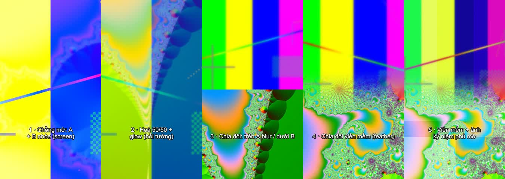
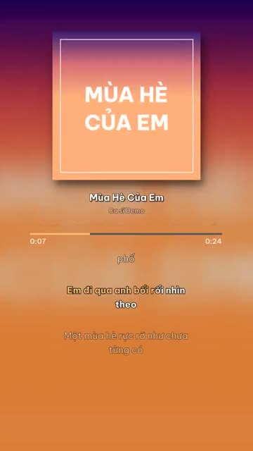

# MV Maker

**Turn a song into a music video or lyric video with an AI coding agent.**
An agent skill for **Claude Code** and **OpenAI Codex** (works with any agent that can read a `SKILL.md` and run a shell),
built on FFmpeg. [Tiếng Việt](README.vi.md)

You describe the idea ("open on a drone flying through a door right on the first line, then old footage of someone
playing piano, chorus = singer on top / fans waving lightsticks below…"). The agent analyses the song (beats, sections,
lyric timing), **proposes edit techniques that fit the meaning of the lyrics**, writes a storyboard and renders an
animatic for you to approve, finds and downloads source clips, and renders the final video for TikTok, Reels, Shorts or YouTube.

| Story MV (animatic → final) | Two videos blended / soft split |
|---|---|
|  |  |

| 7 animated lyric styles | Lyric video from one poster (9:16 and 16:9) |
|---|---|
|  |   |

*(Screenshots use synthetic test footage from `mv demo`.)*

## Features
- **Storyboard-first workflow with 2 approval gates**: the agent writes a `storyboard.md` and renders an animatic
  (placeholder cards + real audio + lyrics + transitions) before downloading anything; the second gate is the footage list.
- **Song analysis**: tempo, beat grid, energy sections (librosa); lyric word timing (faster-whisper) aligned to *your* lyric text.
- **Technique proposals**: a catalogue of ~45 MV techniques (composition, rhythm, transitions, looks, lyrics, storytelling).
  The agent reads the song, then proposes a ⭐ recommendation + alternatives per section with the reason it fits.
- **Layouts**: full, soft-seam split top/bottom & left/right, 3-row, picture-in-picture, landscape-on-blur (`fit_blur`), poster player.
- **Layering**: double exposure / blend modes (screen, overlay, soft light…) with opacity and blur.
- **Looks**: vintage, old film, VHS, B&W, warm/cool, glow, grain, RGB split…
- **Rhythm**: cuts on beats, beat-synced zoom pulse / flash / shake, slow motion, 30+ transitions (dissolve, flash, dip to black, circle open, wipes…).
- **Lyrics**: subtitle (bilingual), karaoke fill, word-by-word, typewriter, kinetic stack, neon, Apple-Music style scrolling.
- **Poster player**: one cover image → lyric video with blurred backdrop, cover card, title/artist, audio visualizer,
  progress bar with time and a scrolling karaoke lyric panel.
- **Sourcing helpers**: YouTube search, section-only downloads (yt-dlp), contact sheets with timecodes so the agent can
  *look* at footage and pick in-points, scene-cut detection.
- **Fast iteration**: per-shot caching, proxy renders (540p), final render with x264, NVENC, QuickSync, AMF or VideoToolbox.
- **Vietnamese-ready**: Vietnamese font pack (Be Vietnam Pro, Anton, Montserrat, Playfair Display, Dancing Script, Pacifico), Vietnamese docs/prompts.

## Requirements
- **FFmpeg** on PATH (Windows: `winget install Gyan.FFmpeg` · macOS: `brew install ffmpeg` · Linux: `apt install ffmpeg`)
- **Python 3.10+**
- Any CPU works for editing (a 4-min 1080×1920 final ≈ real time on a 6-core i5). A GPU only speeds up Whisper and encoding.

Python packages (PyYAML, yt-dlp, librosa, faster-whisper, PySceneDetect, OpenCV) and fonts install automatically
into the skill folder on first run.

## Install

### Claude Code - as a plugin
```bash
claude plugin marketplace add ngoctri3110/mv-maker
claude plugin install mv-maker@mv-maker
```
(or inside a session: `/plugin marketplace add ngoctri3110/mv-maker`, then `/plugin install mv-maker@mv-maker`)

### Claude Code and/or Codex - from a clone
```bash
git clone https://github.com/ngoctri3110/mv-maker.git
cd mv-maker
sh install.sh            # macOS / Linux  (or: sh install.sh codex | claude)
```
```powershell
powershell -ExecutionPolicy Bypass -File install.ps1      # Windows  (or: -Only codex | claude)
```
This links `skills/mv-maker` into `~/.claude/skills/` (Claude Code) and `~/.agents/skills/` (Codex), so `git pull` updates it,
and runs the first-time setup.

### Work inside the repo
Open the clone in Claude Code or Codex: `AGENTS.md` / `CLAUDE.md` point the agent at the skill. Your projects go in `projects/` (git-ignored).

### Try it
```bash
skills/mv-maker/mv demo all        # Windows: skills\mv-maker\mv.cmd demo all
```
Renders four demos into `projects/demo-*` (story MV, blend & split, lyric poster, lyric styles).

## Usage
Talk to the agent, for example:

> Make a 9:16 TikTok MV for `song.mp3`. Lyrics are below. Intro: drone flies to a door that opens on the first line.
> Verse: old footage of someone playing piano. Chorus: singer on top, fans waving lightsticks below, nostalgic.

> Make a lyric video from `poster.jpg` and `song.mp3`, 9:16 and 16:9, karaoke highlight.

The agent then follows the workflow in [`skills/mv-maker/SKILL.md`](skills/mv-maker/SKILL.md):

1. **Intake** - audio, lyrics, ideas, platform, length
2. **Analyse** - beats, sections, lyric timing → `analysis.json`, `lyrics.yaml`
3. **Propose** - song reading, look, ⭐ technique per section + alternatives, lyric styles, "wow moments"
4. **Storyboard + animatic → you approve** (gate 1)
5. **Source footage → you approve the list** (gate 2), download
6. **Pick exact moments** from contact sheets
7. **Proxy edit loop**
8. **Final render** (optionally on a stronger machine)

### CLI (what the agent runs)
| Command | Does |
|---|---|
| `mv new projects/x` | project skeleton (`audio/ sources/ lyrics.txt brief.md storyboard.yaml`) |
| `mv analyze projects/x [--lyrics]` | tempo, beats, sections (+ Whisper word timing) |
| `mv align projects/x` | your `lyrics.txt` + Whisper timing → `lyrics.yaml` |
| `mv review projects/x` | `storyboard.yaml` → readable `storyboard.md` |
| `mv search "query"` | YouTube candidates |
| `mv fetch projects/x` | download sources (only the needed sections) |
| `mv sheet projects/x <id>` / `mv scenes projects/x <id>` | contact sheet with timecodes / scene cuts |
| `mv render projects/x --mode proxy\|final [--encoder h264_nvenc]` | render |
| `mv fonts` / `mv demo [name]` | font pack / demos |

Storyboard reference: [`reference/storyboard-schema.md`](skills/mv-maker/reference/storyboard-schema.md) ·
techniques: [`reference/techniques.md`](skills/mv-maker/reference/techniques.md) ·
lyrics: [`reference/lyrics.md`](skills/mv-maker/reference/lyrics.md)

## Repository layout
```
skills/mv-maker/          the skill (portable: copy/link this folder anywhere)
  SKILL.md                workflow the agent follows
  reference/              technique catalogue, lyric guide, storyboard schema + template
  scripts/mv.py           CLI + FFmpeg graph builder
  scripts/lyrics.py       lyric styles (ASS), poster layout, lyric alignment
  examples/               demo storyboards
  mv, mv.cmd, setup.*     launchers + first-run setup
.claude-plugin/           Claude Code plugin + marketplace manifest
AGENTS.md, CLAUDE.md      in-repo instructions for Codex / Claude Code
install.sh, install.ps1   user-level install for both agents
```

## Copyright & responsible use
This tool downloads and edits media you point it at. **Music and videos on YouTube/TikTok/Facebook are usually
copyrighted**, and downloading them may break the platform's terms. Platforms detect both the song and the footage
(Content ID etc.): expect claims, muting, blocking or no monetization. Use your own footage, material you have
permission for, or licensed / Creative Commons / stock footage (Pexels, Pixabay, Mixkit). The storyboard has a
`rights:` field per source - fill it in before publishing. You are responsible for what you publish.

## Contributing
Issues and PRs welcome. Keep the skill agent-neutral, document new storyboard fields in the schema, and run
`mv demo all --force` and look at the frames before opening a PR (see `AGENTS.md`).

## Credits
[FFmpeg](https://ffmpeg.org) · [yt-dlp](https://github.com/yt-dlp/yt-dlp) · [librosa](https://librosa.org) ·
[faster-whisper](https://github.com/SYSTRAN/faster-whisper) · [PySceneDetect](https://www.scenedetect.com) ·
[libass](https://github.com/libass/libass) · fonts from [Google Fonts](https://fonts.google.com) (SIL Open Font License, downloaded at setup).

## License
[MIT](LICENSE)
