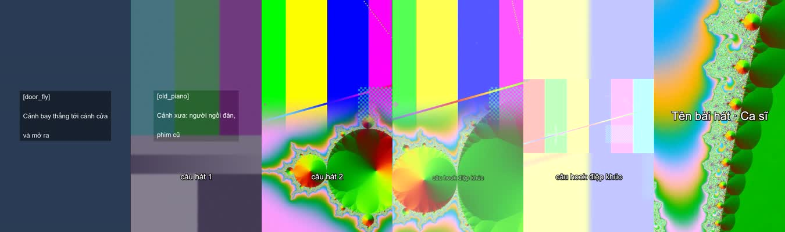
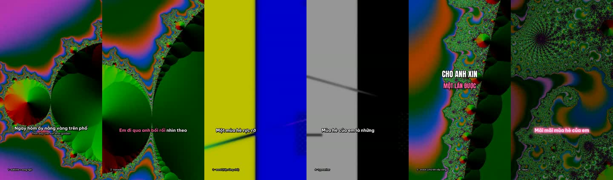
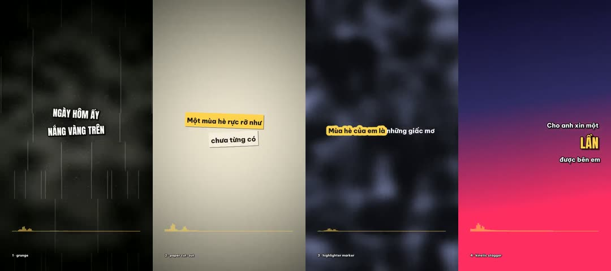
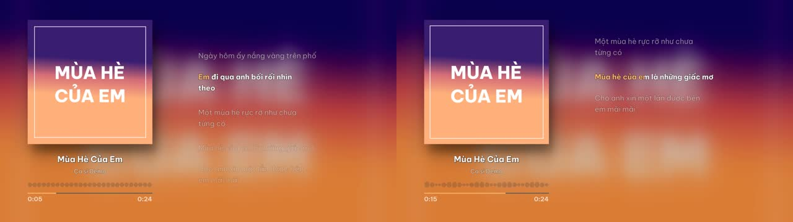
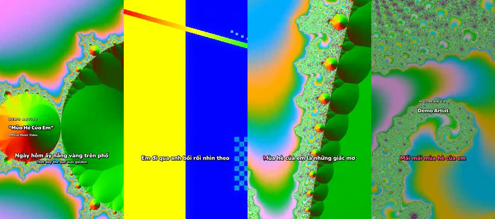
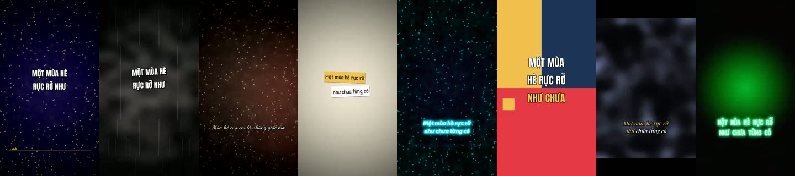

# MV Maker

**Turn a song into a music video or lyric video with an AI coding agent.**
An agent skill for **Claude Code** and **OpenAI Codex** (works with any agent that can read a `SKILL.md` and run a shell),
built on FFmpeg. [Tiếng Việt](README.vi.md)

You describe the idea ("open on a drone flying through a door right on the first line, then old footage of someone
playing piano, chorus = singer on top / fans waving lightsticks below…"). The agent analyses the song (beats, sections,
lyric timing), **proposes edit techniques that fit the meaning of the lyrics**, writes a storyboard and renders an
animatic for you to approve, finds and downloads source clips, and renders the final video for TikTok, Reels, Shorts or YouTube.

| Story MV (animatic → final) | Two videos blended / soft split |
|---|---|
|  |  |

| 11 animated lyric styles | Lyric video from one poster (9:16 and 16:9) |
|---|---|
|   |   |

| Pro MV grammar: title card, lip-synced performance / story intercut, end card | 8 lyric-video templates, no footage needed |
|---|---|
|  |  |

*(Screenshots use synthetic test footage from `mv demo`.)*

## Quick start
In short: **give the agent the audio path (and your clips, if any), say what you want, approve twice.** The agent
does the analysis, storyboard, footage choice, effects and rendering.

**Once per machine**
1. Install **FFmpeg** and **Python 3.10+** (the only manual installs - Python packages and fonts install themselves).
2. Install the skill - Claude Code: `claude plugin marketplace add ngoctri3110/mv-maker` then
   `claude plugin install mv-maker@mv-maker`; Codex: clone this repo and run `install.sh` / `install.ps1`.
3. On first use the agent runs `mv doctor` and **asks** before installing optional extras (e.g. `match`, semantic
   footage matching, ~1-4 GB).

**What you give** - the audio path, plus anything you have:
| You give | The agent makes |
|---|---|
| audio only | a lyric video from a template (generated backgrounds), or finds footage online from your description |
| audio + one poster / cover image | a music-player style lyric video |
| audio + a folder of your clips | picks the right moment of each clip for every shot, cut to the genre's rhythm, with effects |
| audio + the singer performing to the song | the same, plus automatic lip-sync |
| YouTube / TikTok / Facebook links | ranks them and downloads only the matching part, after you approve |

**What the agent asks** (only what is missing): the lyrics (or it fetches synced lyrics of a released song), the mood
and scene ideas, **the platforms** (see below), full song or a short cut, MV with footage / lyric video / poster video.

**Two approval gates**: (1) the storyboard + an animatic (empty frames with music and lyrics) before any footage is
searched or downloaded; (2) the footage list (with a copyright note) before downloading.

**Example prompts**
> Make a 9:16 TikTok MV for `D:\music\song.mp3`, my clips are in `D:\clips`. A sad break-up ballad; rain and night streets in the chorus.

> Make a punk lyric video for `song.mp3` - no footage, grunge style.

> Make this for TikTok, Reels and YouTube: `song.mp3` + the singer's performance take `perf.mp4`.

**Good to know**: a final render takes about the song's length on a 6-core CPU (much less with a GPU) - edit on a
light machine, render the final on a stronger one. Other people's songs and footage are copyrighted: platforms may
mute or block the video - the agent says so before you publish.

### Plan for the platform first
Before footage is chosen the agent asks **where the video goes** and prints a plan (`mv platforms --for tiktok,youtube`):
| | TikTok | Reels | Facebook Reels | Facebook feed | Shorts | YouTube |
|---|---|---|---|---|---|---|
| format | 9:16 | 9:16 | 9:16 | 4:5 | 9:16 | 16:9 |
| max length | 10 min | 3 min | ~90 s | long | 3 min | full song |
| performs best | 15-60 s | 15-90 s | 15-60 s | 30 s-3 min | 20-60 s | full song |
| keep text out of | top 10 %, bottom 25 %, right 14 % | top 14 %, bottom 35 % | top 14 %, bottom 35 % | edges | top 10 %, bottom 25 % | edges |
The plan decides: **the versions** (one edit, re-framed: `mv render <p> --format 16:9`; short cuts of the hook for
length-capped platforms: `mv render <p> --cut 0:45-1:30`), **the source footage to look for** (vertical only →
vertical clips; vertical + YouTube → landscape 4K with centred subjects, so one clip crops to both), **safe zones**
(lyrics and titles are placed inside them automatically), **the hook** (best image in the first 1-3 s) and loudness
(platforms normalise to about -14 LUFS). `mv review` adds a platform check. Numbers were checked in 2026-11 and change
often - [`reference/platforms.md`](skills/mv-maker/reference/platforms.md).

## Features
- **Storyboard-first workflow with 2 approval gates**: the agent writes a `storyboard.md` and renders an animatic
  (placeholder cards + real audio + lyrics + transitions) before downloading anything; the second gate is the footage list.
- **Song analysis**: tempo, beat grid, energy sections (librosa); lyric word timing (faster-whisper) aligned to *your* lyric text.
- **Technique proposals**: a catalogue of ~45 MV techniques (composition, rhythm, transitions, looks, lyrics, storytelling).
  The agent reads the song, then proposes a ⭐ recommendation + alternatives per section with the reason it fits.
- **Layouts**: full, soft-seam split top/bottom & left/right, 3-row, picture-in-picture, landscape-on-blur (`fit_blur`), poster player.
- **Layering**: double exposure / blend modes (screen, overlay, soft light…) with opacity and blur.
- **Looks**: 10 colour grades (teal-orange, kodak, golden, moody, bleach bypass, noir, pastel, matte, cyberpunk,
  cold-blue), cinema bars, drifting light leaks, bloom/halation, handheld drift, motion blur, VHS, old film, grain…
- **Rhythm**: cuts on beats, beat-synced zoom pulse / flash / shake, **speed ramps**, **velocity edits** (slow motion on
  every beat), **freeze frames**, optical-flow slow motion, 35+ transitions (dissolve, flash, glitch, whip, zoom-through,
  zoom-blur, spin, film burn, strobe, dip to black, circle open, wipes…), lyrics that pulse or glow on the beat.
- **One film from mixed footage**: automatic colour matching across cameras and sources, any `.cube` LUT, a crop that
  **follows the subject** when 16:9 footage goes vertical, stabilisation, denoise, local contrast, optional AI upscale,
  and a footage-quality check that flags sources enlarged too much. Film finishing: halation, anamorphic flare, film
  grain, dust, gate weave, lens character. Signature shot: **text behind the person** (MediaPipe matte, optional).
- **Style presets**: `preset: tiktok-remix` (or cinematic-ballad, kpop-stage, lofi-chill, rap-kinetic,
  wedding-romance, edm-neon, vintage-90s, rock-grunge, rnb-night, pop-bright) gives a coherent professional look in one line.
- **Cut like a professional MV, genre by genre** (`genre: pop`): ballad, pop, K-pop, rap, EDM, rock, indie, R&B each
  have their shot length per section, performance / story balance and cutting point. Shots carry a `role`
  (performance, narrative, b-roll) and a `size` (wide → close), and `mv check` (also in `storyboard.md`) flags jump
  cuts, missing size variety, sections cut too slow or too fast, off-beat cuts, a weak 3-second hook and a last chorus
  that doesn't build. **Lip-sync**: `mv sync` matches a performance clip's own sound to the song, then
  `lipsync: true` keeps every cut in sync (multi-cam style). `cut_lead: 1f` cuts a frame before the beat; official-style
  **title card** and **end card**.
- **Lyric-video templates**: `mv auto <project> --template lv-grunge` builds a whole lyric video from the lyrics -
  kinetic, grunge, cozy, paper, glow, minimal blocks, cinematic, retro CRT - with **generated backgrounds** (smoke,
  bokeh, paper, grunge, colour blocks, CRT, gradients; no footage), scenes changing with the song, colour themes, an
  audio spectrum, and lyrics shown early enough to sing along.
- **Footage finding**: licence-aware search across Pexels, Pixabay, Wikimedia Commons, Openverse (and YouTube on
  request) with numbered thumbnail sheets the agent looks at, picks recorded with creator + licence, auto
  `credits.txt`; or **your own clips**, auto-split into scenes and ranked by sharpness, exposure, motion and faces.
- **Footage chosen by meaning** (free, local, SigLIP 2): describe the picture (`look_for: "rain on a window at night"`)
  and `mv scout` ranks online candidates and finds **the matching moment inside YouTube videos before downloading**
  (only that section is fetched); TikTok / Facebook / Instagram links you paste are ranked too. `mv match` picks the
  scene and in-point from **your own clip library** for every `layers: auto` shot - no scene used twice - and
  `mv auto --template pop-bright --genre pop` writes the shot skeleton cut to the genre grammar.
- **Synced lyrics in seconds** for released songs via LRCLIB, or Whisper alignment to your lyric text.
- **Lyrics**: subtitle (bilingual), karaoke fill, word-by-word, typewriter, kinetic stack, neon, Apple-Music style
  scrolling, grunge, paper cut-out, highlighter marker, kinetic stagger (key word huge).
- **Poster player**: one cover image → lyric video with blurred backdrop, cover card, title/artist, audio visualizer,
  progress bar with time and a scrolling karaoke lyric panel.
- **Sourcing helpers**: YouTube search, section-only downloads (yt-dlp), contact sheets with timecodes so the agent can
  *look* at footage and pick in-points, scene-cut detection.
- **Fast iteration**: per-shot caching, proxy renders (540p), final render with x264, NVENC, QuickSync, AMF or VideoToolbox.
- **Ready to publish in one command**: `mv deliver` renders each platform version and a short cut that starts and ends
  on a bar with audio fades, writes SRT captions, picks the best frame for a YouTube thumbnail / vertical cover with the
  title in the MV's font, drafts the description with credits, and checks every file (black or frozen frames, A/V sync,
  loudness and true peak, duration vs platform limits).
- **Token-lean for the agent**: a 2k-token SKILL.md, `mv context` digests instead of whole reference files, a short
  `plan.yaml` expanded into every shot, `mv proof` (the whole edit in one image), `mv status` after a context reset and
  terse command output - roughly 60-70 % fewer tokens per MV at the same quality.
- **Fonts & lettering**: use **any Google Font** by spec (`"Kanit:900i"`, `"Archivo:900i@125"`), downloaded on demand,
  with a catalogue tagged by look and language (Latin, Vietnamese, Cyrillic, Thai, Japanese, Korean, Chinese, Arabic,
  Devanagari). The agent can **match the lyrics to your poster's lettering**: it shortlists fonts, extracts the
  artwork's colours (`mv palette`) and renders a specimen of your real lyric line in each candidate for you to pick
  (`mv fonts preview`), then applies case, colour, outline, shadow and slant (`typo`). Glyph coverage is checked so
  diacritics never fall back to another font.
- **Any language**: the skill is written in English, the agent talks to you in your language and writes the storyboard
  in it (`storyboard.md` labels: English / Vietnamese).

## Requirements
- **FFmpeg** on PATH for analysis/rendering (Windows: `winget install Gyan.FFmpeg` · macOS: `brew install ffmpeg` · Linux: `apt install ffmpeg`). The installer can set up the skill/runtime first and reports this prerequisite if FFmpeg is missing.
- **Python 3.10+**
- Any CPU works for editing (a 4-min 1080×1920 final ≈ real time on a 6-core i5). A GPU only speeds up Whisper and encoding.

Python packages (PyYAML, yt-dlp, librosa, faster-whisper, PySceneDetect, OpenCV) and fonts install automatically
into the skill folder on first run.

### Machine check (`mv doctor`)
Every machine is different, so on first use the agent runs `mv doctor`: it detects CPU/RAM/GPU/disk, checks the FFmpeg
build has every filter needed, **test-encodes with each hardware encoder** (NVENC, QuickSync, AMF, VideoToolbox),
benchmarks a typical MV render and writes `machine.json`. Renders then use the fastest working encoder and Whisper uses
the right model/device automatically. It also lists optional upgrades - GPU Whisper libraries, driver updates, vocal
separation (demucs), a newer yt-dlp, a full FFmpeg build - and **the agent asks you before installing anything**.
```
Profile   tier=standard · render encoder=h264_qsv · jobs=3 · whisper=medium · ~4.4 min per 4-min 1080p final
  [optional] demucs: Vocal separation for much better lyric timing ... -> mv doctor --install demucs
```

### No duplicate installs
Each copy of the skill (plugin, project `.claude/skills`, Codex `~/.agents/skills`) would otherwise build its own
~0.8 GB Python environment. By default `mv doctor` only looks at the skill, the project and PATH. With your OK the agent
runs a **read-only** `mv doctor --scan machine` that finds existing mv-maker copies, Python/conda environments that
already have the packages, a full FFmpeg, installed fonts and downloaded Whisper/Demucs models, and proposes **reuse**:
| Command | Effect |
|---|---|
| `mv doctor --use-shared` | one runtime in `~/.mv-maker/venv` for every copy (created/completed if needed) |
| `mv doctor --use-python <path>` | reuse a complete existing environment (never modified by mv-maker) |
| `mv doctor --use-ffmpeg <path>` | use an installed FFmpeg for mv-maker only |
| `mv doctor --remove-local-venv` | free a copy's own `.venv` after switching |
Install the shared runtime directly with `setup.ps1 -Scope shared` / `sh setup.sh shared`. Launchers pick Python in
this order: `MV_PYTHON` → `runtime.txt` → the skill's `.venv` → `~/.mv-maker/venv`.

## Install

### Claude Code - as a plugin
```bash
claude plugin marketplace add ngoctri3110/mv-maker
claude plugin install mv-maker@mv-maker
```
(or inside a session: `/plugin marketplace add ngoctri3110/mv-maker`, then `/plugin install mv-maker@mv-maker`)

### Claude Code and/or Codex - from a clone
```bash
git clone https://github.com/ngoctri3110/mv-maker.git
cd mv-maker
sh install.sh            # macOS / Linux  (or: sh install.sh codex | claude)
```
```powershell
powershell -ExecutionPolicy Bypass -File install.ps1      # Windows  (or: -Only codex | claude)
```
This links `skills/mv-maker` into `~/.claude/skills/` (Claude Code) and `~/.agents/skills/` (Codex), so `git pull` updates it,
and runs the first-time setup.

### Work inside the repo
Open the clone in Claude Code or Codex: `AGENTS.md` / `CLAUDE.md` point the agent at the skill. Your projects go in `projects/` (git-ignored).

### Try it
```bash
skills/mv-maker/mv demo all        # Windows: skills\mv-maker\mv.cmd demo all
```
Renders eight demos into `projects/demo-*` (story MV, blend & split, lyric poster, lyric styles, pro effects, pop MV
grammar with lip-sync, kinetic lyric styles, a lyric video built from a template) using
synthetic media only - nothing is downloaded.

Optional free API keys for better stock footage: `PEXELS_API_KEY` ([pexels.com/api](https://www.pexels.com/api/)),
`PIXABAY_API_KEY` ([pixabay.com/api/docs](https://pixabay.com/api/docs/)). Wikimedia Commons and Openverse need none.

## Usage
Talk to the agent, for example:

> Make a 9:16 TikTok MV for `song.mp3`. Lyrics are below. Intro: drone flies to a door that opens on the first line.
> Verse: old footage of someone playing piano. Chorus: singer on top, fans waving lightsticks below, nostalgic.

> Make a lyric video from `poster.jpg` and `song.mp3`, 9:16 and 16:9, karaoke highlight.

> Make a professional pop MV: I have a performance take of the singer (`perf.mp4`) and story clips.

> Make a punk lyric video for `song.mp3` - no footage, grunge style.

The agent then follows the workflow in [`skills/mv-maker/SKILL.md`](skills/mv-maker/SKILL.md):

0. **Machine check** - `mv doctor`, you approve any optional installs (first use only)
1. **Intake** - audio, lyrics, ideas, platform, length
2. **Analyse** - beats, sections, lyric timing → `analysis.json`, `lyrics.yaml`
3. **Propose** - song reading, look, ⭐ technique per section + alternatives, lyric styles, "wow moments"
4. **Storyboard + animatic → you approve** (gate 1)
5. **Source footage → you approve the list** (gate 2), download
6. **Pick exact moments** from contact sheets
7. **Proxy edit loop**
8. **Final render** (optionally on a stronger machine)

### CLI (what the agent runs)
| Command | Does |
|---|---|
| `mv doctor [--quick] [--install ids]` | machine check, benchmark, profile, install approved upgrades |
| `mv new projects/x` | project skeleton (`audio/ sources/ lyrics.txt brief.md storyboard.yaml`) |
| `mv analyze projects/x [--lyrics]` | tempo, beats, sections (+ Whisper word timing) |
| `mv align projects/x` | your `lyrics.txt` + Whisper timing → `lyrics.yaml` |
| `mv status projects/x` | where the project stands + the next step (cheap to read after a break) |
| `mv context --project projects/x --type mv --mood "nostalgia"` | planning digest: only the genre, presets, techniques and fields this project needs |
| `mv auto projects/x --plan plan.yaml` | footage-MV storyboard from a short per-section plan ([`plan-template.yaml`](skills/mv-maker/reference/plan-template.yaml)) |
| `mv review projects/x` | `storyboard.yaml` → readable `storyboard.md` (+ edit check) |
| `mv proof projects/x [--only S03,S07]` | one labelled frame per shot in a single sheet - check the whole edit at a glance |
| `mv check projects/x [--genre pop]` · `mv genres` | edit check against the genre's cutting grammar · list genres |
| `mv sync projects/x <id>` | lip-sync offset of a performance clip (audio match) → `picks.yaml` |
| `mv auto projects/x --template lv-kinetic` | lyric-video storyboard from `lyrics.yaml` + a template |
| `mv find "query" --project projects/x --slot id` | licence-aware stock/CC search + numbered contact sheet |
| `mv pick projects/x <id> <slot>:<n>` · `mv ingest projects/x <folder>` | use a candidate · register & rank your own clips |
| `mv scout projects/x` | search + rank + find the moment in YouTube videos for every source with `search:` |
| `mv match projects/x [--pick S03:2]` | choose scenes from your footage for `layers: auto` shots by `look_for` |
| `mv lyrics fetch projects/x --artist A --title T` | synced lyrics from LRCLIB |
| `mv presets` · `mv credits projects/x` | style presets + lyric templates · attribution list |
| `mv search "query"` | YouTube candidates |
| `mv fetch projects/x` | download sources (direct files capped at 300 MB, YouTube sections via yt-dlp) |
| `mv sheet projects/x <id>` / `mv scenes projects/x <id>` | contact sheet with timecodes / scene cuts |
| `mv render projects/x --mode proxy\|final [--encoder h264_nvenc]` | render |
| `mv platforms [--for tiktok,youtube]` · `mv render projects/x --format 16:9` · `--cut 0:45-1:30` | platform plan · another aspect version · a short cut (snapped to bars, audio fades) |
| `mv deliver projects/x` | every platform version + short cut + SRT captions + thumbnails + description + QA → `out/deliver.md` |
| `mv qa projects/x` · `mv thumbnail projects/x [--at m:ss]` · `mv srt projects/x` | check renders (black/frozen frames, sync, loudness) · thumbnail / cover · captions |
| `mv fonts list\|get\|check\|preview` · `mv palette ` | font catalogue, download, coverage, specimen over the poster · artwork colours |
| `mv demo [name]` | demos |

Storyboard reference: [`reference/storyboard-schema.md`](skills/mv-maker/reference/storyboard-schema.md) ·
techniques: [`reference/techniques.md`](skills/mv-maker/reference/techniques.md) ·
genres: [`reference/genres.md`](skills/mv-maker/reference/genres.md) ·
footage matching: [`reference/matching.md`](skills/mv-maker/reference/matching.md) ·
lyrics: [`reference/lyrics.md`](skills/mv-maker/reference/lyrics.md)

## Repository layout
```
skills/mv-maker/          the skill (portable: copy/link this folder anywhere)
  SKILL.md                workflow the agent follows
  reference/              technique catalogue, lyric guide, storyboard schema + template
  scripts/mv.py           CLI + FFmpeg graph builder
  scripts/lyrics.py       lyric styles (ASS), poster layout, lyric alignment
  scripts/doctor.py       machine check, encoder tests, benchmark, recommendations
  scripts/fonts.py        font catalogue, Google Fonts downloader, glyph coverage, palette
  scripts/sources.py      stock/CC search, contact sheets, downloads, own-footage scoring, LRCLIB
  scripts/runtime.py      runtime choice, duplicate-install detection, reuse/shared runtime
  examples/               demo storyboards
  mv, mv.cmd, setup.*     launchers + first-run setup
.claude-plugin/           Claude Code plugin + marketplace manifest
AGENTS.md, CLAUDE.md      in-repo instructions for Codex / Claude Code
install.sh, install.ps1   user-level install for both agents
```

## Copyright & responsible use
This tool downloads and edits media you point it at. **Music and videos on YouTube/TikTok/Facebook are usually
copyrighted**, and downloading them may break the platform's terms. Platforms detect both the song and the footage
(Content ID etc.): expect claims, muting, blocking or no monetization. Use your own footage, material you have
permission for, or licensed / Creative Commons / stock footage (Pexels, Pixabay, Mixkit). The storyboard has a
`rights:` field per source - fill it in before publishing. You are responsible for what you publish.

## Contributing
Issues and PRs welcome. Keep the skill agent-neutral, document new storyboard fields in the schema, and run
`mv demo all --force` and look at the frames before opening a PR (see `AGENTS.md`).

## Credits
[FFmpeg](https://ffmpeg.org) · [yt-dlp](https://github.com/yt-dlp/yt-dlp) · [librosa](https://librosa.org) ·
[faster-whisper](https://github.com/SYSTRAN/faster-whisper) · [PySceneDetect](https://www.scenedetect.com) ·
[libass](https://github.com/libass/libass) · fonts from [Google Fonts](https://fonts.google.com) (SIL Open Font License, downloaded at setup).

## License
[MIT](LICENSE)
