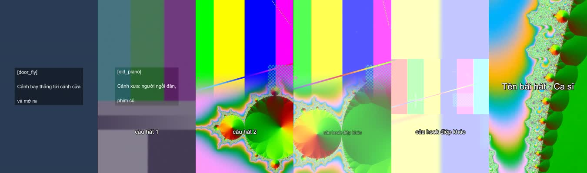
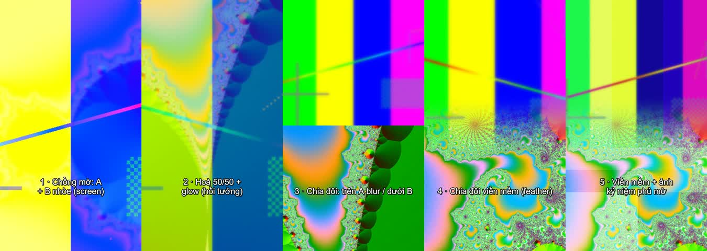
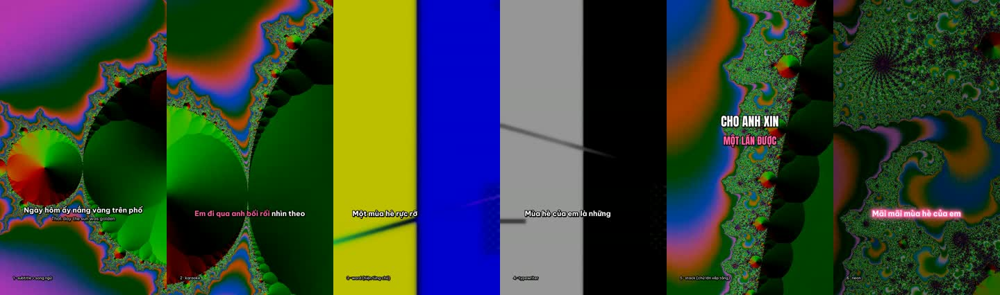
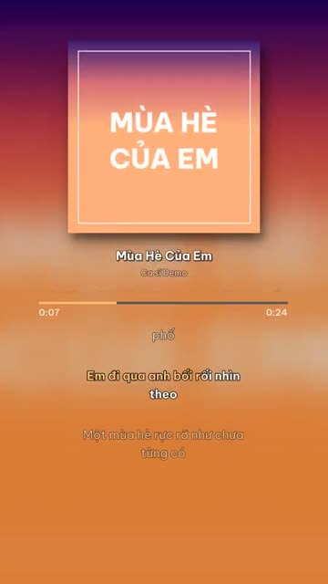
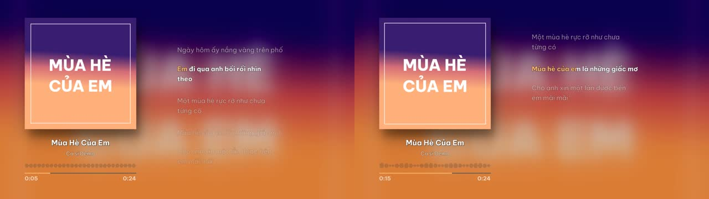

# MV Maker

**Biến một bài hát thành MV ca nhạc hoặc video lyric bằng AI agent** - skill cho **Claude Code** và **OpenAI Codex**
(dùng được với mọi agent đọc được `SKILL.md` và chạy được lệnh shell), dựng bằng FFmpeg. [English](README.md)

Bạn mô tả ý tưởng ("mở đầu camera bay thẳng tới cửa, cửa mở đúng câu hát đầu, rồi cảnh xưa ngồi đàn, điệp khúc
trên là ca sĩ hát dưới là fan vẫy lightstick…"). Agent sẽ phân tích bài hát (nhịp, đoạn, thời điểm từng chữ trong lời),
**đề xuất kỹ thuật edit hợp với ý nghĩa lời bài hát**, viết storyboard và render bản nháp (animatic) để bạn duyệt,
tìm và tải clip nguồn, rồi render video cho TikTok, Reels, Shorts hoặc YouTube.




 

*(Ảnh chụp từ footage giả lập của lệnh `mv demo`.)*

## Tính năng
- **Duyệt storyboard trước, dựng sau**, 2 bước duyệt: storyboard + video nháp (chưa cần footage), rồi danh sách clip nguồn.
- **Phân tích bài hát**: tempo, beat, đoạn cao trào; thời gian từng chữ (Whisper) khớp với lời *bạn* đưa.
- **Đề xuất kỹ thuật**: catalogue ~45 kỹ thuật MV; agent đọc ý nghĩa bài hát và đề xuất ⭐ phương án chính + phương án khác cho từng đoạn, kèm lý do.
- **Bố cục**: toàn khung, chia đôi trên/dưới & trái/phải **viền mềm**, 3 tầng, khung trong khung, khung ngang trên nền blur, poster.
- **Chồng mờ** nhiều video (screen, overlay, soft light…), độ mờ, blur.
- **Màu**: vintage, phim cũ, VHS, đen trắng, ấm/lạnh, glow, hạt phim, RGB split…
- **Nhịp**: cắt theo beat, zoom nảy / nháy sáng / rung theo beat, slow-motion, 30+ kiểu chuyển cảnh.
- **Lyric**: phụ đề (song ngữ), karaoke tô màu, hiện từng chữ, đánh máy, chữ lớn xếp tầng, neon, cuộn kiểu Apple Music.
- **Poster player**: 1 ảnh poster → video lyric có nền blur, bìa, tên bài/ca sĩ, sóng nhạc, thanh tiến trình, khung lyric chạy.
- **Tìm footage**: tìm YouTube, tải đúng đoạn cần, ảnh lưới khung hình có timecode để agent *nhìn* và chọn điểm cắt.
- **Dựng nhanh**: cache từng shot, bản nháp 540p, bản cuối dùng x264 / NVENC / QuickSync / AMF / VideoToolbox.
- **Font tiếng Việt** đẹp tải sẵn: Be Vietnam Pro, Anton, Montserrat, Playfair Display, Dancing Script, Pacifico.

## Cần có
- **FFmpeg** (Windows: `winget install Gyan.FFmpeg` · macOS: `brew install ffmpeg` · Linux: `apt install ffmpeg`)
- **Python 3.10+**
- CPU thường là đủ (bài 4 phút 1080×1920 render ≈ bằng thời lượng bài trên i5 6 nhân). GPU chỉ giúp Whisper và encode nhanh hơn.

### Kiểm tra máy (`mv doctor`)
Mỗi máy một cấu hình, nên lần đầu dùng agent sẽ chạy `mv doctor`: đo CPU/RAM/GPU/ổ đĩa, kiểm tra FFmpeg đủ filter,
**encode thử từng bộ encode phần cứng** (NVENC, QuickSync, AMF, VideoToolbox), benchmark render và lưu `machine.json`.
Sau đó render tự dùng encoder nhanh nhất chạy được, Whisper tự chọn model/thiết bị phù hợp. Nó cũng đề xuất nâng cấp
(Whisper chạy GPU, cập nhật driver, tách giọng demucs, yt-dlp mới, FFmpeg bản đầy đủ) và **agent sẽ hỏi bạn trước khi cài bất cứ thứ gì**.

## Cài đặt
**Claude Code (plugin):**
```bash
claude plugin marketplace add ngoctri3110/mv-maker
claude plugin install mv-maker@mv-maker
```
**Claude Code và/hoặc Codex (từ bản clone):**
```bash
git clone https://github.com/ngoctri3110/mv-maker.git && cd mv-maker
sh install.sh                                          # macOS / Linux
powershell -ExecutionPolicy Bypass -File install.ps1   # Windows
```
Lệnh này liên kết skill vào `~/.claude/skills/` và `~/.agents/skills/` (Codex) rồi cài thư viện + font.

**Chạy thử:** `skills/mv-maker/mv demo all` (Windows: `skills\mv-maker\mv.cmd demo all`) → 4 video demo trong `projects/demo-*`.

## Cách dùng
Nói với agent, ví dụ:

> Làm MV TikTok 9:16 cho `song.mp3`, lời bên dưới. Intro: flycam bay tới cửa, cửa mở đúng câu đầu.
> Verse: cảnh xưa ngồi đàn. Điệp khúc: trên là ca sĩ hát, dưới là fan vẫy lightstick, cảm giác hoài niệm.

> Làm video lyric từ `poster.jpg` và `song.mp3`, bản 9:16 và 16:9, lyric karaoke.

Quy trình chi tiết: [`skills/mv-maker/SKILL.md`](skills/mv-maker/SKILL.md) · kỹ thuật:
[`techniques.md`](skills/mv-maker/reference/techniques.md) · lyric: [`lyrics.md`](skills/mv-maker/reference/lyrics.md) ·
storyboard: [`storyboard-schema.md`](skills/mv-maker/reference/storyboard-schema.md)

## Bản quyền & sử dụng có trách nhiệm
Nhạc và video trên YouTube/TikTok/Facebook thường có bản quyền; tải về có thể vi phạm điều khoản nền tảng. Nền tảng
nhận diện được cả bài hát lẫn footage (Content ID…): video có thể bị claim, tắt tiếng, chặn hoặc không kiếm tiền được.
Hãy dùng footage tự quay, có xin phép, có giấy phép / Creative Commons / kho miễn phí (Pexels, Pixabay, Mixkit) và
điền cột `rights:` trong storyboard trước khi đăng. Bạn chịu trách nhiệm với nội dung mình đăng.

## Giấy phép
[MIT](LICENSE)
